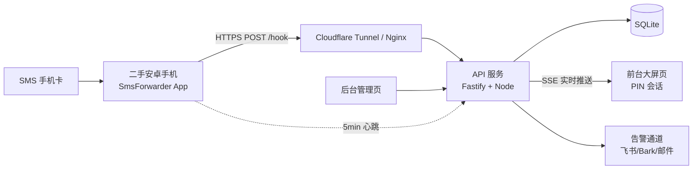

# SMSFor 开发方案（个人短信验证码中转服务）

> 版本：v0.1（方案稿）　日期：2026-10-22
> 定位：个人自用。仅接收本人名下手机号的短信，不对外提供任何代收服务。

---

## 1. 项目定位与边界

### 1.1 要解决的问题
Apple ID 绑定在一个 SMS 手机号上；主力手机不方便/不想插这张卡。用一台二手安卓手机插卡常驻，把短信实时转发到自建 Web 服务，随时随地看到**验证码数字**。

### 1.2 核心诉求（按优先级）
| 优先级 | 需求 | 说明 |
|---|---|---|
| P0 | 24h 稳定收码 | 手机端断网/被杀后台要能自愈并有告警 |
| P0 | 前台只显示验证码 | 超大字号，隐藏发件人，只显示收到时间 |
| P0 | 安全 | 公开页面绝不能变成"全网共享的验证码" |
| P1 | 后台访问审计 | 谁看过、何时看、看了哪条、成功与否 |
| P1 | IP 拉黑 | 支持单 IP 与 CIDR 段，一键拉黑 |
| P2 | 可扩展 | 多设备、多通道备份、通知推送 |

### 1.3 安全红线（必须遵守）
1. **前台不可匿名直出验证码**：至少一层门禁（私密路径 Token / PIN / 设备信任）。裸奔页面 ≈ 把 Apple ID 交给全网。
2. **验证码自动过期**：默认 10 分钟后前台自动清空，历史不默认展示。
3. **不存完整短信原文**：只落库"验证码 + 收到时间 + 内部来源标记"，原文可选加密留存或直接丢弃。
4. **全链路 HTTPS**，后台与前台分离入口。
5. 仅本人号码。禁止接收/转发他人短信。

---

## 2. 总体架构



数据流很短：**手机 POST → 解析入库 → SSE 推给已登录的大屏 → 后台记录访问日志**。不引入 Redis/MQ，一台 1C1G 小机器足够。

---

## 3. 手机端方案（决定 70% 的稳定性）

### 3.1 硬件选型
- 二手安卓：红米 / 真我 / 荣耀 低端机即可（¥150–350），要求：能插 Nano-SIM、Android 8+、屏幕能常亮。
- 备选：4G 随身 Wi-Fi 棒 + 安卓备用机；不建议用功能机（无法 webhook）。

### 3.2 转发 App：SmsForwarder（开源，GitHub: pppscn/SmsForwarder）
选它的理由：
- 支持 **Webhook 自定义 JSON 模板**，可直接 POST 到我们的接口；
- 支持**规则匹配**（包含/不包含关键字、指定号码），脏短信在手机上先过滤掉，省流量也省日志；
- 支持多通道并行（Webhook 失败可同时发飞书/Bark），天然形成备份；
- 支持失败重试、开机自启、心跳上报。

Webhook 模板建议（只发必要字段，不发明文全文也够用，见 5.1）：
```json
{
  "device": "sms-01",
  "token": "{{DEVICE_TOKEN}}",
  "from": "{{FROM}}",
  "text": "{{MSG}}",
  "ts": "{{RECEIVE_TIME}}"
}
```

### 3.3 保活清单（照抄，逐项打勾）
1. 关闭电池优化 / 允许后台高耗电（国产 ROM 需"自启动 + 关联启动 + 锁后台"三项全开）。
2. 开发者选项 → 开启"充电时不休眠"。
3. 设置静态 DHCP 保留 IP，或固定 Wi-Fi；关闭自动切换移动数据（可选：插一张流量卡防止宽带断网）。
4. 关闭系统自动更新、关闭"夜间自动重启"。
5. 关闭 SIM 卡 PIN 锁（防止重启后卡锁死收不到短信）。
6. 手机只登录这个用途的 Google/厂商账号，不复用个人账号；开启锁屏密码。
7. 长期插电：建议用**带过充保护的插座/定时通断**，并把电池充到 60–80% 区间（长期满电鼓包是最常见的翻车点）。
8. App 内开启"心跳上报"，服务端 15 分钟无心跳即告警。

---

## 4. 服务端技术选型

| 层 | 选型 | 理由 |
|---|---|---|
| 运行时 | Node.js 20 + Fastify | 单进程、轻、启动快 |
| 存储 | SQLite（better-sqlite3，WAL） | 单机零运维，日增量极小 |
| 实时推送 | **SSE**（`text/event-stream`） | 单向推送场景最合适，自带重连，比 WebSocket 简单 |
| 前端 | 原生 HTML/CSS/JS（无构建） | 大屏页只要几十行；后台表格也够用 |
| 鉴权 | PIN + HttpOnly Session Cookie | 手机浏览器输入 6 位 PIN，免注册体系 |
| 部署 | Docker Compose + Cloudflare Tunnel | 免公网 IP、免备案、免费 HTTPS |

不引入 ORM、不引入前端框架，减少维护成本。

---

## 5. 功能设计

### 5.1 接收与解析（`POST /hook/:deviceToken`）
1. 校验设备 Token（每台手机独立），失败直接 403 并计入黑名单评分。
2. 提取验证码，优先级从高到低：
   - 关键词邻近：`验证码|校验码|动态码|确认码|verification code|OTP|code` 之后 20 字符内的 4–8 位数字；
   - 全文 4–8 位独立数字，排除：11 位手机号、日期（`20xx`）、金额（带 `元/¥`）、订单号（>8 位）、百分比。
   - 多个候选时取**最靠前**且最贴近关键词的一个；仍歧义则标记 `ambiguous` 并展示全部候选（前台用小字并列）。
3. 过滤规则（服务端二次校验，防止 App 规则被绕过）：
   - 发件人白名单（可空=全收），仅内部记录，不前台展示；
   - 关键词黑名单（营销、广告、106 开头的通知类）。
4. 落库后广播 SSE：`{id, code, receivedAt}`。
5. 同一验证码 60 秒内重复到达则合并（去重），避免双卡/双通道重复。

### 5.2 前台大屏页（`/` 或 `/v/:secret`）
- **视觉**：全屏深色，验证码 `clamp(6rem, 28vw, 22rem)` 等宽字体，居中；下方一行细字"HH:mm:ss 收到"；底部 N 分钟倒计时进度条。
- **不显示**：发件人、短信正文、任何可推断来源的信息。
- **实时**：SSE 连接，新码到达时数字做 150ms 淡入+轻微缩放，**不闪屏、不重排**。
- **过期**：到点自动淡出为"等待新的验证码…"，同时前端清空 DOM，防止截图/回看。
- **门禁**：首次访问要求输入 PIN（6 位），成功后下发 HttpOnly Cookie（30 天）；连续 5 次失败锁定该 IP 15 分钟。
- **静音横幅**：若检测到多个设备同时在线，顶部提示"另有 1 个会话在查看"。
- **可选大屏模式**：`/screen` 纯展示页（无交互、无来源信息），用于常亮显示器/电视。

### 5.3 后台（`/admin`，独立路径 + 二次 PIN 或 IP 白名单）
1. **访问审计列表**：时间、IP、归属地、UA 摘要、结果（成功/失败/被拉黑）、查看的是哪条验证码、停留时长。
2. **统计卡片**：今日访问数 / 独立 IP / 失败次数 / 当前在线；近 7 天折线。
3. **IP 管理**：一键拉黑（单 IP 或 CIDR）、备注、有效期（永久/1 天/7 天）、解封、黑名单命中计数。
4. **设备管理**：Token 轮换、最后心跳时间、在线状态、离线告警开关。
5. **消息管理**：最近 N 条（默认只显示码与时间）、一键清空、导出 CSV。
6. **系统设置**：验证码有效期、PIN 修改、告警通道配置、是否留存原文。

### 5.4 安全设计（逐条落地）
| 风险 | 对策 |
|---|---|
| 页面被搜索引擎/爬虫抓到 | `X-Robots-Tag: noindex`、`robots.txt` 全禁、路径随机化 |
| 暴力猜 PIN | 每 IP 5 次/15 分钟锁定 + 全局 20 次/小时熔断 + 递增延迟 |
| 恶意刷接口 | Hook 接口设备 Token + 限流（1 次/秒/设备）；全局 token bucket |
| 验证码被长期留存 | 默认 10 分钟过期、前端清 DOM、服务端 `code` 字段 TTL 后置空（仅留哈希供审计） |
| 后台被扫 | 独立子域 + Cloudflare Access 或 IP 白名单；Basic Auth 兜底 |
| 日志泄露 | 后台接口只回脱敏 IP（`1.2.*.*`），完整 IP 仅存库 |
| 掉线无感知 | 心跳 + 15 分钟无消息/无心跳双条件告警 |
| 会话劫持 | Cookie `HttpOnly; Secure; SameSite=Strict`；PIN 改后全端失效 |

---

## 6. 数据模型（SQLite）

```sql
-- 设备
CREATE TABLE devices (
  id INTEGER PRIMARY KEY,
  name TEXT NOT NULL,              -- sms-01
  token TEXT NOT NULL UNIQUE,      -- 32 位随机
  last_heartbeat_at INTEGER,
  enabled INTEGER DEFAULT 1
);

-- 短信/验证码（不存原文；raw_enc 可选，AES-GCM 加密）
CREATE TABLE messages (
  id INTEGER PRIMARY KEY,
  device_id INTEGER NOT NULL,
  code TEXT,                       -- 提取出的验证码
  code_hash TEXT,                  -- 过期后用于审计比对
  candidates TEXT,                 -- JSON 数组，歧义时使用
  sender_tag TEXT,                 -- 内部来源标记，永不向前台输出
  received_at INTEGER NOT NULL,
  expires_at INTEGER NOT NULL,
  dedupe_key TEXT UNIQUE,
  status TEXT DEFAULT 'active'     -- active | expired | dropped
);
CREATE INDEX idx_msg_time ON messages(received_at DESC);

-- 访问审计
CREATE TABLE views (
  id INTEGER PRIMARY KEY,
  message_id INTEGER,
  ip TEXT NOT NULL,
  ip_masked TEXT,
  ua TEXT,
  country TEXT, region TEXT, city TEXT,
  session_id TEXT,
  result TEXT,                     -- success | denied | blocked
  viewed_at INTEGER NOT NULL,
  dwell_ms INTEGER
);
CREATE INDEX idx_views_time ON views(viewed_at DESC);
CREATE INDEX idx_views_ip ON views(ip);

-- IP 规则（支持 CIDR）
CREATE TABLE ip_rules (
  id INTEGER PRIMARY KEY,
  cidr TEXT NOT NULL,              -- 1.2.3.4 或 1.2.3.0/24
  action TEXT NOT NULL,            -- block | allow
  note TEXT,
  hits INTEGER DEFAULT 0,
  expires_at INTEGER,              -- NULL = 永久
  created_at INTEGER NOT NULL
);

CREATE TABLE settings (key TEXT PRIMARY KEY, value TEXT);
CREATE TABLE audit_log (id INTEGER PRIMARY KEY, actor TEXT, action TEXT, detail TEXT, at INTEGER);
```

---

## 7. 接口清单

| 方法 | 路径 | 鉴权 | 说明 |
|---|---|---|---|
| POST | `/hook/:deviceToken` | 设备 Token | 接收转发短信，返回 204 |
| POST | `/api/heartbeat/:deviceToken` | 设备 Token | 心跳 |
| POST | `/api/auth` | — | PIN 登录，下发 Cookie |
| POST | `/api/auth/logout` | 会话 | 退出 |
| GET | `/api/latest` | 会话 | 当前有效验证码 + 收到时间 |
| GET | `/api/stream` | 会话 | SSE 实时推送 |
| GET | `/admin/api/views` | 管理员 | 审计分页 + 筛选（IP/时间/结果） |
| GET | `/admin/api/stats` | 管理员 | 统计聚合（日/时/独立 IP） |
| POST | `/admin/api/ip-rules` | 管理员 | 新增拉黑规则 |
| DELETE | `/admin/api/ip-rules/:id` | 管理员 | 解封 |
| GET | `/admin/api/devices` | 管理员 | 设备状态 |
| POST | `/admin/api/devices/:id/rotate` | 管理员 | 轮换 Token |
| DELETE | `/admin/api/messages` | 管理员 | 清空历史 |

限流：`/api/auth` 5 次/15min/IP；`/hook/*` 2 次/秒/设备；全站 60 次/分/IP。

---

## 8. 部署方案对比

| 方案 | 成本 | 备案 | 稳定性 | 适合 |
|---|---|---|---|---|
| **A. 家里设备 + Cloudflare Tunnel** | ¥0（复用 NAS/旧电脑） | 免 | 取决于家宽与断电 | 推荐首选 |
| B. 国内轻量 VPS（阿里/腾讯 2C2G） | ¥100–300/年 | **需 ICP 备案** | 高 | 想要异地容灾 |
| C. 香港/海外 VPS | $3–5/月 | 免 | 中（跨境延迟） | 不想备案 |
| D. Cloudflare Workers + D1 | ¥0 | 免 | 高 | 纯 Serverless，但 SSE 和 SQLite 受限 |

默认按 **部署到香港/海外 VPS（方案 C）+ Nginx HTTPS** 实现，容器只监听本机端口；若后续想零成本落地，可改用方案 A 的 Cloudflare Tunnel，无需改代码。

```yaml
# docker-compose.yml（示意）
services:
  smsfor:
    build: .
    restart: always
    volumes: ["./data:/app/data"]
    environment:
      - TZ=Asia/Shanghai
      - PIN_HASH=${PIN_HASH}
      - ADMIN_PIN_HASH=${ADMIN_PIN_HASH}
  tunnel:
    image: cloudflare/cloudflared:latest
    restart: always
    command: tunnel --no-autoupdate run
    environment: [TUNNEL_TOKEN=${TUNNEL_TOKEN}]
```

---

## 9. 里程碑

| 阶段 | 交付物 | 验收标准 |
|---|---|---|
| M1 打通链路 | Hook 接口 + SQLite + 手机 App 配置 | 手机发测试短信，库里 3 秒内出现记录 |
| M2 前台大屏 | PIN 登录 + SSE + 大屏页 + 过期清屏 | 两台设备同时打开，新码秒级同步，10 分钟自动消失 |
| M3 安全加固 | 限流、锁定、IP 规则、noindex | 暴力试 PIN 被锁；黑名单 IP 拿不到任何响应体 |
| M4 后台 | 审计、统计、设备管理、导出 | 能看到每次查看的 IP/时间/结果，可一键拉黑 |
| M5 稳定性 | 心跳、离线告警、备份脚本、保活清单 | 拔掉手机网线 15 分钟内收到告警邮件/推送 |
| M6 收尾 | README、部署文档、恢复演练 | 新机器 10 分钟内部署完成 |

每个里程碑独立可验证，M1 完成后即使后续不做也能用。

---

## 10. 成本估算

| 项 | 金额 |
|---|---|
| 二手安卓机 | ¥150–350（一次性） |
| 充电头/线/过充保护插座 | ¥30–60 |
| 域名（可选） | ¥30–60/年 |
| 服务器 | ¥0（方案 A）～¥300/年（方案 B） |
| 短信卡月租 | 按运营商套餐 |

---

## 11. 风险与对策

| 风险 | 影响 | 对策 |
|---|---|---|
| 安卓杀后台导致漏码 | 高 | 保活清单 + 心跳告警 + App 多通道（同时发 Bark/飞书）兜底 |
| 家宽断网/断电 | 高 | 手机插一张流量卡做双通道；服务端在云上（方案 B）可规避 |
| 页面被爆破 | 高 | PIN 锁定 + 全局熔断 + Cloudflare Access + 蜜罐 |
| 验证码被截图外泄 | 中 | 10 分钟过期、查看即可清除、后台可见异常查看 |
| 二手手机电池鼓包 | 中 | 限充 60–80%、过充保护插座、每季度检查 |
| 号码是 Apple ID 唯一 2FA | 高 | **务必再加一台受信任设备 + 保存恢复密钥**，否则手机丢失将无法登录 |

---

## 12. 延伸点子（按价值排序）

1. **多通道冗余（强烈建议）**：Webhook 之外同时配 Bark / 飞书机器人 / 邮件。手机上直接双发，服务端挂了也能收到码。
2. **心跳看门狗**：手机 5 分钟一次心跳，服务端超时即推送"转发器离线"，避免"以为在跑其实早死了"。
3. **一次性分享链接**：给家人临时看码，生成 5 分钟有效、仅能看 1 次的链接，用完即焚。
4. **PWA + Web Push**：手机锁屏也能收到"新验证码到了"的系统通知，不必一直开页面。
5. **常亮大屏模式**：`/screen` 全屏黑底超大数字 + 语音播报（Web Speech），适合显示器/平板常驻。
6. **异常访问告警**：同一 IP 高频、异地首次访问、非常用 UA → 立即推送告警并自动临时封禁。
7. **蜜罐字段**：页面藏一个不可见输入框，机器人填了直接永久封 IP。
8. **双人复核模式**：敏感场景下，查看验证码需两个已授权设备同时在线确认（防单人手机被盗）。
9. **验证码质量统计**：记录每个发件人的到达频率，识别营销短信自动降权/丢弃。
10. **审计防篡改**：`views` 表按天生成链式哈希，后台可校验日志未被改动。
11. **Telegram / 飞书 Bot 查询**：在聊天里发 `/latest` 拿当前验证码，比开网页快。
12. **号码迁移预案**：文档化"手机丢失/损坏 → 补卡 → 换机 → 重配 App"的完整恢复流程。

---

## 13. 下一步

1. 确认部署位置（方案 A/B/C）与前台门禁方式（PIN / 私密长链接）。
2. 按 M1 → M6 顺序实现，每阶段提交到 master。
3. 先跑通 M1 再谈大屏视觉，避免在样式上过早投入。
